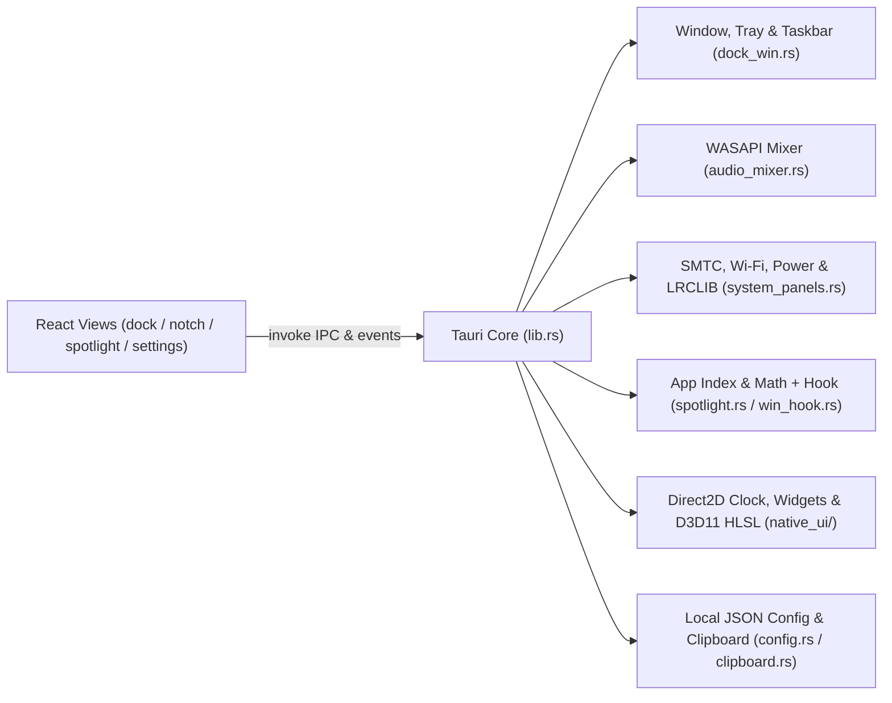

# Anti-Bar

A Windows 10/11 desktop companion providing a glass Dock, Dynamic Island Notch, `Alt + Space` Spotlight launcher, per-app WASAPI audio mixer, clipboard history, and native Direct2D/Direct3D11 modules—packaged alongside a static showcase site.

-0078D4)


<!-- TODO: Add GitHub Actions release badge after setting your GitHub repository slug -->

## Quick Download (Windows x64)

- **Portable ZIP (Recommended):** [`release/Anti-Bar-portable-win64.zip`](./release/Anti-Bar-portable-win64.zip) (6.0 MB) — extract both files to any folder and launch `anti-bar.exe`.
- **Direct Binary:** [`release/anti-bar.exe`](./release/anti-bar.exe) (22.3 MB) — requires [`release/WebView2Loader.dll`](./release/WebView2Loader.dll) in the same directory and the Microsoft Edge WebView2 Runtime.

<!-- TODO: Capture and commit a desktop screenshot or GIF (e.g. docs/preview.png) if you want a live preview image in the README -->

## Features

- **Glass Dock (`DockWindow.tsx`, `dock_win.rs`):** Renders pinned shortcuts alongside running Win32/UWP windows (`EnumWindows`) with PNG icon extraction, hover magnification, a Downloads stack popover, Recycle Bin counter/empty action, WASAPI per-app volume mixer (`audio_mixer.rs`), and Wi-Fi/battery/power Control Center (`system_panels.rs`).
- **Dynamic Island Notch (`NotchWindow.tsx`, `system_panels.rs`, `clipboard.rs`):** Expandable top-center pill showing active Windows SMTC media metadata/controls, synced LRCLIB lyrics (`lrclib.net`), persisted clipboard history (pin/copy/clear), file shelf, and focus timer.
- **Global Spotlight Launcher (`SpotlightWindow.tsx`, `spotlight.rs`, `win_hook.rs`):** Opens on `Alt + Space` (`Ctrl + Alt + Space` fallback, plus optional `WH_KEYBOARD_LL` Windows-key hook) to filter installed applications and evaluate arithmetic expressions locally.
- **Taskbar-Safe Positioning & Opt-In Hiding (`lib.rs`, `dock_win.rs`):** Positions the Dock cleanly above the monitor `work_area()` by default, or hides `Shell_TrayWnd` and `Shell_SecondaryTrayWnd` when **Hide Windows Taskbar** is toggled—automatically restoring the Windows taskbar on quit or exit.
- **Native Win32 Clock & GPU Modules (`native_ui/`):** Direct2D/DirectWrite desktop clock window (`desktop_clock.rs`), magnetic-snap widget layout & iCalendar `.ics` parser (`desktop_widgets.rs`), and compiled HLSL Direct3D11 Genie minimize shader (`genie.rs`).
- **Product Showcase Site (`site/`):** Self-contained landing page linking directly to [`release/Anti-Bar-portable-win64.zip`](./release/Anti-Bar-portable-win64.zip).

## Tech Stack

| Layer | Technology | Version |
| :--- | :--- | :--- |
| Desktop Shell | Tauri (`tauri`, `tauri-build`, `tray-icon`) | `2` (`@tauri-apps/api` `^2.2.0`) |
| Backend | Rust (`edition = "2021"`, `windows` crate) | `0.58` (`windows`) |
| Async & Serialization | `tokio`, `serde`, `serde_json` | `1` |
| Graphics & Assets | `png`, `base64`, `dirs` | `0.17` / `0.22` / `5` |
| Frontend UI | React, React DOM | `^18.3.1` |
| Icons | `lucide-react` | `^0.468.0` |
| Tooling | TypeScript, Vite, `@vitejs/plugin-react` | `^5.7.2` / `^6.0.3` / `^4.3.4` |

## Architecture

Anti-Bar runs a single-instance Tauri host (`com.antibar.app`, guarded by `Local\AntiBarSingletonMutex`) managing four React views served via `index.html?view=<view>` alongside background pollers, Win32 hotkey/keyboard hooks, and Direct2D/D3D11 native helpers. Configuration persists locally as JSON via `dirs::data_dir()` at `%APPDATA%\com.antibar.app\config.json`.



## Project Structure

```text
Anti-Bar/
├── .github/workflows/
│   └── release.yml                 # Builds portable ZIP + NSIS installer on v* tags
├── .gitignore                      # Ignores node_modules, target, dist, dist-bin, shots
├── README.md
├── release/
│   ├── Anti-Bar-portable-win64.zip # Single-file portable archive (exe + WebView2Loader.dll)
│   ├── anti-bar.exe                # Prebuilt Windows x64 binary (--features custom-protocol)
│   └── WebView2Loader.dll          # Required WebView2 loader alongside anti-bar.exe
├── app/
│   ├── package.json                # Vite + React + TypeScript scripts
│   ├── vite.config.ts
│   ├── src/
│   │   ├── main.tsx                # Query-param router (?view=dock|notch|spotlight|settings)
│   │   ├── i18n.ts                 # UI translations
│   │   ├── types.ts                # IPC payload TypeScript interfaces
│   │   └── windows/                # DockWindow, NotchWindow, SpotlightWindow, SettingsWindow
│   └── src-tauri/
│       ├── Cargo.toml              # Rust dependencies & custom-protocol feature
│       ├── tauri.conf.json         # Window defaults & NSIS bundle config
│       └── src/
│           ├── main.rs             # Binary entry point + integration/unit test suite
│           ├── lib.rs              # Tauri commands, tray menu, hotkeys, pollers, exit hooks
│           ├── audio_mixer.rs      # WASAPI per-session audio control
│           ├── clipboard.rs        # Clipboard polling & history storage
│           ├── config.rs           # AppConfig schema & JSON persistence
│           ├── dock_win.rs         # Window enumeration, icons, trash, taskbar hide/restore
│           ├── spotlight.rs        # Installed app indexing & math expression evaluator
│           ├── system_panels.rs    # SMTC media, LRCLIB lyrics, Wi-Fi scan, battery/power
│           ├── win_hook.rs         # Opt-in WH_KEYBOARD_LL Win-key listener
│           └── native_ui/          # Direct2D desktop clock, widget helpers, D3D11 HLSL shader
└── site/
    ├── index.html                  # Product showcase site with download links
    ├── privacy.html
    └── terms.html
```

## Getting Started

### Prerequisites

- **OS:** Windows 10 or Windows 11 (x64) with Microsoft Edge WebView2 Runtime.
- **Node.js & npm:** Node.js `22+` (verified on `v26.7.0` / CI `22`).
- **Rust Toolchain:**
  - **MSVC (for full NSIS packaging via `npm run tauri build`):** `stable-x86_64-pc-windows-msvc` + Visual Studio C++ Build Tools (Windows 10/11 SDK).
  - **MinGW / WinLibs GNU (portable release `.exe`):** `stable-x86_64-pc-windows-gnu` + GCC/MinGW `bin` on `PATH`.

### Installation & Build from Source

1. Install frontend dependencies and build the static bundle (`app/dist/`):
   ```powershell
   cd app
   npm install
   npx tsc --noEmit
   npm run build
   ```

2. Build the Rust backend:
   - **MSVC (`x86_64-pc-windows-msvc`):**
     ```powershell
     cd app/src-tauri
     cargo build --release --features custom-protocol
     ```
     Or package a standalone NSIS installer from `app/`:
     ```powershell
     cd app
     npm run tauri build
     ```
   - **WinLibs GNU (`x86_64-pc-windows-gnu`):** If your workspace path contains spaces, point `CARGO_TARGET_DIR` to a spaceless path so GNU `windres` succeeds:
     ```powershell
     $wbin = "$env:LOCALAPPDATA\winlibs\mingw64\bin"
     $dbg = "$env:LOCALAPPDATA\antibar-target\debug"
     $cleanPath = ($env:Path -split ';' | Where-Object { $_ -and ($_ -notlike '*MinGW*') }) -join ';'
     $env:Path = "$dbg;$env:USERPROFILE\.cargo\bin;$wbin;$cleanPath"
     $env:CARGO_TARGET_DIR = "$env:LOCALAPPDATA\antibar-target"
     cd app/src-tauri
     cargo +stable-x86_64-pc-windows-gnu build --release --features custom-protocol
     ```

### Configuration

Anti-Bar stores settings in `%APPDATA%\com.antibar.app\config.json` (editable via **Anti-Bar Settings** in the tray or Dock gear icon) rather than `.env` files:

| Setting (`config.json`) | Purpose | Default |
| :--- | :--- | :--- |
| `theme` / `glassMaterial` | UI theme (`dark`/`light`) & glass (`frosted`/`liquid`/`matte`/`classic`) | `"dark"` / `"frosted"` |
| `iconSize` / `magnification` | Dock icon base size (`36..64`) & hover magnification (`1.0..1.65`) | `48` / `1.38` |
| `hideInFullscreen` | Hides the Dock when a fullscreen app is active | `true` |
| `hideWindowsTaskbar` | Hides Windows `Shell_TrayWnd` / secondary taskbars while running | `false` |
| `useWinKeyForLaunchpad` | Hooks Windows key tap (`WH_KEYBOARD_LL`) to toggle Spotlight | `false` |
| `notchEnabled` / `showLyrics` | Toggles top Dynamic Island Notch and LRCLIB synced lyrics lookup | `true` / `true` |
| `genieEffect` | Enables/disables the GPU Genie effect state | `true` |
| `clockEnabled` | Toggles the native Direct2D desktop clock window | `false` |

### Running

- **Prebuilt binary:**
  ```powershell
  Start-Process ".\release\anti-bar.exe"
  ```
- **Development server (from `app/`):**
  ```powershell
  npm run tauri dev
  ```

> **Note:** Close any competing dock/launcher (such as Wizzly) before launching so `Alt + Space` and screen-edge overlays do not collide.

## Usage

- **Tray Menu (`Anti-Bar`):**
  - **Show / Hide Dock**
  - **Hide / Show Windows Taskbar** (automatically restored on exit)
  - **Spotlight (`Alt+Space`)**
  - **Anti-Bar Settings**
  - **Quit Anti-Bar**
- **Keyboard Shortcuts:** `Alt + Space` (primary) or `Ctrl + Alt + Space` (backup) toggles Spotlight; `Esc`, `ArrowUp`, `ArrowDown`, and `Enter` navigate Spotlight results.
- **Publishing GitHub Releases:** Push a version tag (`git tag v0.1.0 && git push origin v0.1.0`) to trigger [`.github/workflows/release.yml`](./.github/workflows/release.yml) and attach `Anti-Bar-portable-win64.zip`, `anti-bar.exe`, and the NSIS installer to GitHub Releases.

## Testing

Type-check the frontend (`app/`):
```powershell
cd app
npx tsc --noEmit
```

Run the Rust test suite (`6` tests covering config round-trip, Spotlight math evaluation, clipboard deduplication, LRC parsing, WASAPI clamp / Wi-Fi deduplication / power validation, widget snap / `.ics` parsing / D3D11 HLSL compilation):
```powershell
cd app/src-tauri
cargo test --bin anti-bar
```
*(When using the GNU toolchain on a path with spaces, set `CARGO_TARGET_DIR` and `PATH` as shown in the build section and pass `+stable-x86_64-pc-windows-gnu test --bin anti-bar`.)*

## Contributing & License

- **Contributing:** <!-- TODO: Add CONTRIBUTING.md guidelines if accepting external pull requests -->
- **License:** <!-- TODO: Add a LICENSE file (e.g., MIT or Apache-2.0) before publishing as open source -->
